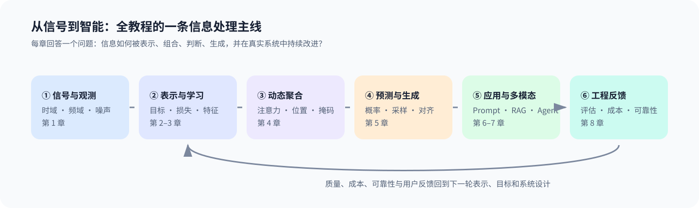

# 从信号到智能

`signal-to-intelligence` | 从数字信号处理到大模型与多模态系统的思想连接与代码实践

**版本：** v3.2

## 项目概览

**定位：** 面向具有信号处理、通信或控制背景的工程师，把 DSP、统计、优化、深度学习、Transformer、LLM 和多模态串成一条可迁移的学习路径。

- **思想主线：** 不把新模型写成彼此割裂的技术清单，而是比较它们如何表示信息、利用上下文、优化目标，并在约束下完成预测、生成和决策。
- **学习方式：** 正文建立直觉和概念边界，轻量实验用于观察现象，综合项目用于连接多个知识点。
- **内容边界：** 本教程不是严格数学教材；需要严格证明的内容放在扩展阅读和参考资料中。

**受众：** 学过 DSP、控制、通信或机器学习基础，希望把已有知识迁移到现代大模型与多模态系统的学习者。

[📖 **在线文档：** https://datawhalechina.github.io/signal-to-intelligence/](https://datawhalechina.github.io/signal-to-intelligence/)
[🔗 **GitHub 仓库：** https://github.com/datawhalechina/signal-to-intelligence](https://github.com/datawhalechina/signal-to-intelligence)

## 学习主线

本教程围绕“信息如何被表示、学习、组合、生成、对齐并部署”这条问题链展开：



第 1—4 章建立从经典信号处理到 Transformer 的思想桥梁；第 5—6 章解释语言模型如何训练，以及 Prompt、微调、RAG、Agent 分别解决什么问题；第 7 章把“表示与对齐”从图文扩展到一般信号；第 8 章用质量、延迟、资源和成本约束检验模型能否落地。

## Quick Start

下面的安装过程通常需要网络。安装完成后，默认测试和章节轻量实验只使用 CPU，可离线运行，无需 API Key、GPU 或模型下载。

```bash
git clone https://github.com/datawhalechina/signal-to-intelligence.git
cd signal-to-intelligence

# Linux / macOS / WSL2
python3 -m venv .venv
source .venv/bin/activate
python -m pip install -e .

# 验证安装：运行全部测试
make test

# 运行一个章节实验：自注意力与图表生成
make run-exp-ch04
```

接下来可按目标选择：

| 目标 | 入口 |
|------|------|
| 系统学习理论主线 | [在线文档](https://datawhalechina.github.io/signal-to-intelligence/) 或 [学习路径](docs/00_introduction/02_learning_paths.md) |
| 运行其他章节的 CPU 轻量实验 | `make help` 或 [代码运行指南](docs/appendix/C_code_guide.md) |
| 交互式修改参数 | [Notebook 指南](notebooks/README.md) |
| 完成章节最低实践或综合项目 | [项目实践说明](projects/README.md) |
| 配置 Docker、GPU 或 API 实验 | [环境配置](docs/appendix/B_environment_setup.md) 与 [代码运行指南](docs/appendix/C_code_guide.md) |
| 本地预览文档站 | 安装 Node.js 后运行 `npm install && npm run docs:dev` |

如果不确定从哪里开始，先阅读[如何使用本教程](docs/00_introduction/05_how_to_use_this_tutorial.md)。当前 Notebook 提供 Google Colab 入口；ModelScope 与 CNB 尚无经过维护者验证的一键入口，因此不列为可用路径。

## 章节导航

| 章节 | 核心问题 |
|------|----------|
| [第0章：导论](docs/00_introduction/README.md) | 如何根据已有基础选择学习路径并使用本教程？ |
| [第1章：DSP基础](docs/01_dsp/README.md) | 如何从时域、频域和状态空间理解信号表示？ |
| [第2章：优化与机器学习](docs/02_optimization/README.md) | 估计、损失函数和迭代优化如何连接传统机器学习？ |
| [第3章：深度学习快速通道](docs/03_deep_learning_fast/README.md) | 模型如何从数据中学习可迁移的层级表示？ |
| [第4章：Transformer详解](docs/04_transformer/README.md) | 注意力如何按内容组织上下文并形成新的信息表示？ |
| [第5章：LLM原理](docs/05_llm_basics/README.md) | 下一个 Token 预测如何扩展为生成、涌现能力与对齐？ |
| [第6章：LLM应用](docs/06_llm_applications/README.md) | Prompt、微调、RAG、Agent 分别适合解决什么问题？ |
| [第7章：多模态LLM](docs/07_multimodal_llm/README.md) | 视觉与非视觉信号如何进入统一表示空间并与语言对齐？ |
| [第8章：LLM工程实践与部署](docs/08_llm_engineering/README.md) | 如何在质量、延迟、资源和成本约束下完成系统闭环？ |

代码细目和运行方式见 [附录 C：代码运行指南](docs/appendix/C_code_guide.md)，数学前置导航见 [附录 D：数学前置导航](docs/appendix/D_math_quick_reference.md)。章节项目和综合项目见 [`projects/`](projects/README.md)。

## 仓库结构

```text
docs/       教程正文、章节索引与附录
code/       与章节对应的可运行实验，作为核心实现来源
notebooks/  面向交互学习的 Notebook，复用 code/ 中的实现
projects/   跨知识点的综合项目与分阶段扩展
tests/      代码行为、文档入口和项目元数据测试
deploy/     CPU / GPU Docker 环境配置
```

正文负责解释概念边界，实验负责观察现象，项目负责综合应用，测试负责防止代码与文档入口失配。更完整的维护约定见[项目维护说明](docs/appendix/E_project_maintenance.md)。

---

## 维护与贡献

> [!NOTE]
> 教程主体内容和主要工程结构已经完成，当前持续优化概念表达、实验质量与学习导航。

| 姓名 | 职责 | 简介 |
| :---- | :---- | :---- |
| `Datawhale` | 开源社区 | 项目组织、协作与发布支持 |
| `lynn_jingjing` | 项目负责人 | 仓库维护者，负责教程主线、代码重构、文档整理与发布维护 |

欢迎通过 [Issue](https://github.com/datawhalechina/signal-to-intelligence/issues) 报告概念、公式、代码或文档问题。提交修改前，请先阅读[项目维护说明](docs/appendix/E_project_maintenance.md)，其中包含工程文件、图片同步、测试和 Notebook 复用规则。

---

## LICENSE

<a rel="license" href="https://creativecommons.org/licenses/by-nc-sa/4.0/"></a><br />
本项目采用 **知识共享署名-非商业性使用-相同方式共享 4.0 国际许可协议（CC BY-NC-SA 4.0）**。

- 使用本项目内容时请保留署名并注明来源。
- 不得用于商业用途。
- 如对内容进行再创作或再发布，请保持相同许可。

具体条款可参考 [Creative Commons 官方说明](https://creativecommons.org/licenses/by-nc-sa/4.0/)。如需商用授权或其他许可安排，请联系仓库维护者。
