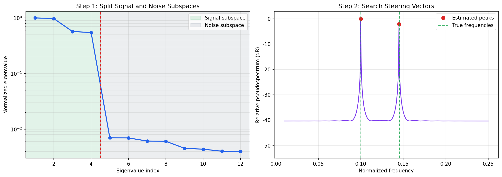

# 1.8 矩阵分解应用

**核心问题：** 如何用矩阵分解方法解决信号处理问题？

---

## 矩阵分解基础

### 奇异值分解（Singular Value Decomposition, SVD）

**定义：** 任何矩阵都可以分解为三个矩阵的乘积。

$$\mathbf{A} = \mathbf{U} \boldsymbol{\Sigma} \mathbf{V}^H$$

其中：
- $\mathbf{U}$：$m \times m$ 酉矩阵（左奇异向量）
- $\boldsymbol{\Sigma}$：$m \times n$ 对角矩阵（奇异值）
- $\mathbf{V}^H$：$n \times n$ 酉矩阵的共轭转置（右奇异向量）

**奇异值：** $\sigma_1 \geq \sigma_2 \geq \cdots \geq \sigma_r > 0$

**秩：** $\text{rank}(\mathbf{A}) = r$（非零奇异值的个数）

### 特征值分解（Eigenvalue Decomposition, EVD）

**定义：** 对于方阵 $\mathbf{A}$，存在特征向量和特征值。

$$\mathbf{A} = \mathbf{Q} \boldsymbol{\Lambda} \mathbf{Q}^{-1}$$

其中：
- $\mathbf{Q}$：特征向量矩阵
- $\boldsymbol{\Lambda}$：特征值对角矩阵

**对于Hermitian矩阵：** $\mathbf{A} = \mathbf{A}^H$

$$\mathbf{A} = \mathbf{Q} \boldsymbol{\Lambda} \mathbf{Q}^H$$

其中 $\mathbf{Q}$ 是酉矩阵。

### QR分解

**定义：** 矩阵分解为正交矩阵和上三角矩阵的乘积。

$$\mathbf{A} = \mathbf{Q} \mathbf{R}$$

其中：
- $\mathbf{Q}$：$m \times n$ 正交矩阵
- $\mathbf{R}$：$n \times n$ 上三角矩阵

**应用：** 数值稳定的最小二乘求解。

---

## 信号处理中的矩阵表示

### 数据矩阵

**问题：** 如何用矩阵表示信号？

**方法1：向量表示**
$$\mathbf{x} = [x[0], x[1], \ldots, x[N-1]]^T$$

**方法2：Hankel矩阵**
$$\mathbf{H} = \begin{bmatrix}
x[0] & x[1] & \cdots & x[M-1] \\
x[1] & x[2] & \cdots & x[M] \\
\vdots & \vdots & \ddots & \vdots \\
x[N-M] & x[N-M+1] & \cdots & x[N-1]
\end{bmatrix}$$

**用途：** 将一维信号转换为二维矩阵，便于矩阵分解。

### 协方差矩阵

**定义：** 信号的二阶统计特性。

$$\mathbf{R} = E[\mathbf{x} \mathbf{x}^H]$$

**样本协方差矩阵：**
$$\hat{\mathbf{R}} = \frac{1}{N} \sum_{n=0}^{N-1} \mathbf{x}[n] \mathbf{x}^H[n]$$

**性质：**
- Hermitian矩阵：$\mathbf{R} = \mathbf{R}^H$
- 半正定：所有特征值 $\geq 0$
- 特征值反映信号的功率分布

---

## 子空间方法

### 信号子空间和噪声子空间

**问题：** 给定观测 $\mathbf{y} = \mathbf{s} + \mathbf{w}$，如何分离信号和噪声？

**方法：** 对协方差矩阵进行EVD。

$$\mathbf{R} = \mathbf{Q}_s \boldsymbol{\Lambda}_s \mathbf{Q}_s^H + \mathbf{Q}_w \boldsymbol{\Lambda}_w \mathbf{Q}_w^H$$

其中：
- $\mathbf{Q}_s$：信号子空间（对应大特征值）
- $\mathbf{Q}_w$：噪声子空间（对应小特征值）

**关键性质：** 信号子空间和噪声子空间正交。

$$\mathbf{Q}_s^H \mathbf{Q}_w = 0$$

### MUSIC算法（Multiple Signal Classification）

**问题：** 估计多个信号的频率。

**观测模型：**
$$y[n] = \sum_{k=1}^{K} A_k e^{j2\pi f_k n} + w[n]$$

**MUSIC算法步骤：**

1. **构造数据矩阵**
   $$\mathbf{X} = [x[0], x[1], \ldots, x[N-M]]$$
   其中 $x[n] = [y[n], y[n+1], \ldots, y[n+M-1]]^T$

2. **计算协方差矩阵**
   $$\mathbf{R} = \frac{1}{N-M+1} \mathbf{X} \mathbf{X}^H$$

3. **EVD分解**
   $$\mathbf{R} = \mathbf{Q}_s \boldsymbol{\Lambda}_s \mathbf{Q}_s^H + \mathbf{Q}_w \boldsymbol{\Lambda}_w \mathbf{Q}_w^H$$

4. **MUSIC谱**
   $$P_{\text{MUSIC}}(f) = \frac{1}{\|\mathbf{Q}_w^H \mathbf{a}(f)\|^2}$$
   其中 $\mathbf{a}(f) = [1, e^{j2\pi f}, \ldots, e^{j2\pi f(M-1)}]^T$ 是导向向量

5. **峰值检测**
   找到 $P_{\text{MUSIC}}(f)$ 的 $K$ 个最大峰值

**优点：**
- 高分辨率：能分离接近的频率
- 在模型匹配和高SNR等条件下，性能可接近CRB

**代码文件：** [`code/ch01_dsp/music_algorithm.py`](../../code/ch01_dsp/music_algorithm.py)  
**运行方式：** `python code/ch01_dsp/music_algorithm.py`

*图1.9：矩阵分解在信号子空间分析中的示意。通过分解协方差矩阵，可以把主要信号结构与噪声成分区分开。*

**缺点：**
- 需要知道信号个数 $K$
- 计算复杂度较高

### ESPRIT算法（Estimation of Signal Parameters via Rotational Invariance Techniques）

**思想：** 利用信号的旋转不变性。

**优点：**
- 不需要知道导向向量
- 计算复杂度低
- 性能好

**应用：** 频率估计、到达角估计

---

## 主成分分析（Principal Component Analysis, PCA）

### 原理

**问题：** 如何从高维数据中提取主要特征？

**方法：** 找到方差最大的方向。

**步骤：**

1. **中心化数据**
   $$\mathbf{X}_c = \mathbf{X} - \bar{\mathbf{X}}$$

2. **计算协方差矩阵**
   $$\mathbf{C} = \frac{1}{N} \mathbf{X}_c^T \mathbf{X}_c$$

3. **EVD分解**
   $$\mathbf{C} = \mathbf{Q} \boldsymbol{\Lambda} \mathbf{Q}^T$$

4. **选择主成分**
   选择特征值最大的 $K$ 个特征向量

5. **降维**
   $$\mathbf{Y} = \mathbf{X}_c \mathbf{Q}[:, 1:K]$$

### 在信号处理中的应用

**1. 信号去噪**

**思想：** 信号集中在少数几个主成分，噪声分散在所有主成分。

**方法：**
- 对信号进行PCA
- 保留主要的主成分
- 丢弃小的主成分（主要是噪声）
- 重构信号

**2. 特征提取**

**应用：** 从复杂信号中提取关键特征。

**例子：**
- 语音识别：从语谱图提取主要特征
- 人脸识别：从人脸图像提取特征脸（eigenfaces）
- 心电图分析：提取心跳的主要特征

PCA、SVD 以及基于滤波器组的特征（如 MFCC、HOG、SIFT）都可用于压缩或描述信号。PCA 和 SVD 按线性代数准则选择方向，手工特征由设计者规定变换；神经网络则根据训练目标学习表示。三者的假设与适用范围不同，详见 [第3章深度学习基础](../03_deep_learning_fast/02_cnn_essence.md)。

*图1.8b：传统特征提取与深度学习特征的对比。上行：PCA 主成分，通过统计方差最大化方向手工提取；中行：CNN 学到的 Gabor 类滤波器，通过任务驱动自动优化；下行：PCA 各主成分解释的方差比例，少数主成分即可覆盖大部分信息。*

**代码文件：** [`code/ch01_dsp/feature_extraction_comparison.py`](../../code/ch01_dsp/feature_extraction_comparison.py)  
**运行方式：** `python code/ch01_dsp/feature_extraction_comparison.py`

**3. 数据压缩**

**思想：** 用少数主成分表示原始数据。

**压缩率：**
$$\text{压缩率} = \frac{K}{D} \times 100\%$$

其中 $K$ 是保留的主成分数，$D$ 是原始维数。

---

## 低秩近似和去噪

### 低秩近似

**问题：** 用低秩矩阵近似原始矩阵。

**方法：** 使用SVD的截断版本。

$$\mathbf{A}_r = \sum_{i=1}^{r} \sigma_i \mathbf{u}_i \mathbf{v}_i^H$$

其中 $r < \text{rank}(\mathbf{A})$。

**性质：**
- 最小化Frobenius范数误差
- 保留最重要的信息

### 信号去噪

**观测模型：**
$$\mathbf{Y} = \mathbf{S} + \mathbf{W}$$

其中 $\mathbf{S}$ 是低秩信号，$\mathbf{W}$ 是噪声。

**去噪方法：**

1. **SVD分解**
   $$\mathbf{Y} = \mathbf{U} \boldsymbol{\Sigma} \mathbf{V}^H$$

2. **阈值处理**
   $$\hat{\sigma}_i = \begin{cases} \sigma_i & \text{if } \sigma_i > \tau \\ 0 & \text{otherwise} \end{cases}$$

3. **重构**
   $$\hat{\mathbf{S}} = \mathbf{U} \hat{\boldsymbol{\Sigma}} \mathbf{V}^H$$

**优点：**
- 简单有效
- 保留信号结构

---

## 从子空间到频率估计

MUSIC 先把协方差矩阵的特征向量分成信号子空间和噪声子空间，再寻找与噪声子空间近似正交的导向向量。实验中的实信号包含两个正弦分量，因此 Hankel 矩阵的理想信号秩取 4。

**代码文件：** [`code/ch01_dsp/music_algorithm.py`](../../code/ch01_dsp/music_algorithm.py)  
**运行方式：** `python code/ch01_dsp/music_algorithm.py`

*图 1.10：同一次实验中的两个步骤。左图按设定秩划分信号与噪声子空间，右图用噪声子空间构造 MUSIC 伪谱并读取峰值。参数为 $N=256$、SNR = 12 dB、归一化频率 0.100 和 0.145；这张图用于解释过程，不用于证明 MUSIC 普遍优于其他估计器。*

子空间方法还可用于阵列到达角估计；低秩近似可用于去噪和压缩。能否获得更小误差，取决于信号数估计、样本量、噪声模型和信号间隔。

---

## 本节小结

本节的关键不是记住算法清单，而是理解三个操作：用特征值或奇异值判断主要维度，用子空间正交性寻找信号参数，用截断分解完成低秩重构。

---

## 与后续章节的联系

矩阵分解提供了后续章节会反复使用的语言：主方向对应表示压缩，低秩约束对应参数或特征的有效维度，正交化关系到数值稳定性。这里先掌握“分解—选择—重构”的过程，不需要提前套用到所有模型。

---

**下一章：** [第2章：优化与机器学习](../02_optimization/README.md)
