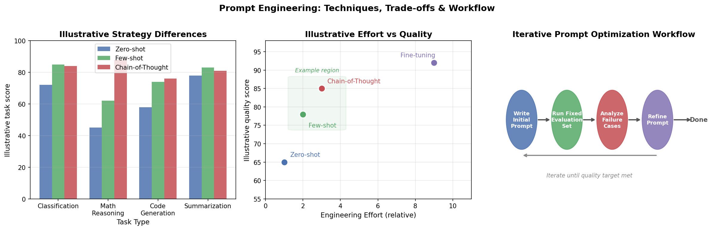

# 6.1 Prompt 工程

**核心问题：** 如何通过设计 Prompt 充分发挥 LLM 的能力？

---

## Prompt 工程的定位

Prompt 工程通常适合作为低风险起点：它不更新参数，也不要求先建设知识库或工具执行层。但“成本最低”不是无条件成立，长示例、长上下文和反复调用同样会增加延迟与费用。

```
先用 Prompt 明确任务、输入和验收标准
  ├─ 缺外部知识 → 评估 RAG
  ├─ 缺稳定行为 → 评估微调
  └─ 需要执行动作 → 评估工具流水线或 Agent
```

---

## 基本原则

### 清晰具体

```
❌ 模糊：总结这篇文章
✅ 具体：用 3 句话总结以下文章的核心观点，
         面向没有技术背景的读者
```

### 提供上下文

```
❌ 无上下文：翻译这段话
✅ 有上下文：你是一名医学翻译，请将以下临床报告
             从英文翻译成中文，保留专业术语的准确性
```

### 指定输出格式

```
请分析以下代码的问题，输出格式：
1. 问题描述（一句话）
2. 根本原因
3. 修复建议（代码示例）
```

---

## 核心技巧

### Zero-shot vs Few-shot

```
Zero-shot（无示例）：
  将以下句子分类为正面/负面情感：
  "这部电影太棒了！"

Few-shot（有示例）：
  示例1：这部电影太棒了！→ 正面
  示例2：服务态度很差。→ 负面
  示例3：还行吧，一般般。→ 中性
  请分类：这家餐厅的食物让我失望。
```

**何时用 Few-shot：** 任务格式复杂、输出有特定结构要求、Zero-shot 效果不稳定时。

### Chain-of-Thought（思维链）

把复杂任务拆成可检查的中间问题，有时能提升数学、逻辑和多步分析任务的稳定性。生产系统通常只要求可核验的简要依据或结构化中间结果，不应依赖模型暴露完整内部推理过程：

```
❌ 直接回答：
  问：Roger 有 5 个网球，买了 2 罐（每罐 3 个），共几个？
  答：11

✅ Chain-of-Thought：
  问：Roger 有 5 个网球，买了 2 罐（每罐 3 个），共几个？
  让我一步步思考：
  - Roger 原有 5 个
  - 买了 2 罐 × 3 个/罐 = 6 个
  - 共 5 + 6 = 11 个
  答：11
```

**触发方式：**
- 显式：要求模型先分析条件、再给结论
- Few-shot CoT：提供带推理过程的示例
- 推理模型：部分模型会在内部使用更长的推理过程，外部 prompt 不一定需要显式写出完整思维链

### 角色设定（System Prompt）

```
你是一名资深的 Python 工程师，有 10 年后端开发经验。
你的回答应该：
- 优先考虑代码的可维护性和性能
- 指出潜在的安全风险
- 提供具体的代码示例
```

**作用边界：** 角色设定主要提供语气、受众和任务约束，可能改善输出一致性，但不会自动赋予模型真实资质、最新知识或更高事实准确率。

### 结构化输出

要求模型输出 JSON 或特定格式，便于程序处理：

```
请分析以下代码，以 JSON 格式输出：
{
  "issues": [{"type": "...", "line": ..., "description": "..."}],
  "severity": "high/medium/low",
  "fix_suggestion": "..."
}
```

**注意：** 仅在文本里要求 JSON 仍可能出现字段缺失或类型错误。若调用接口支持 schema 约束，应同时使用结构化输出能力，并在应用侧做解析、校验和失败重试。

---

## 高级技巧

### Self-Consistency（自洽性）

对同一问题采样多个候选，再按答案一致性或外部验证器选择结果：

```
对同一问题生成 5 个回答
→ 答案A出现3次，答案B出现2次
→ 选择答案A
```

**适用场景：** 数学推理、逻辑判断等有明确答案或可验证结果的任务。候选彼此相关时，多数票不等于正确答案，并且会线性增加调用成本。

### Tree of Thought（思维树）

探索多个推理分支，选择最优路径：

```
问题
├─ 思路A → 中间结果A1 → 最终答案A
├─ 思路B → 中间结果B1 → 死路（回溯）
│              └─ 中间结果B2 → 最终答案B
└─ 思路C → ...
```

**适用场景：** 需要探索多种可能性的复杂问题（规划、创意写作）。

### 迭代优化

Prompt 工程是迭代过程：

```
1. 写初始 Prompt
2. 在覆盖常见、边界和失败场景的固定小型评估集上测试
3. 分析失败案例
4. 针对性修改 Prompt
5. 重复直到满足要求
```

---

## 常见陷阱

| 陷阱 | 问题 | 解决方法 |
|------|------|---------|
| 过度限制 | 太多约束导致模型无法发挥 | 只指定必要约束 |
| 歧义指令 | 模型理解与预期不同 | 提供示例澄清 |
| 上下文过长 | 关键信息被稀释 | 把重要信息放在开头或结尾 |
| 只有否定指令 | 未说明期望行为，模型仍可能采用错误替代方案 | 同时说明禁止项和可接受行为 |
| 忽略温度参数 | 创意任务通常需要更高温度，确定性任务通常需要更低温度 | 根据任务调整 temperature |

---

## 与其他方法的配合

```
Prompt 工程 + RAG：
  Prompt 设计检索策略和回答格式
  RAG 提供最新知识

Prompt 工程 + 微调：
  微调固定输出格式和领域风格
  Prompt 工程处理具体任务变体

System Prompt + User Prompt：
  System：设定角色、约束、输出格式
  User：具体任务内容
```

---

## In-Context Learning vs 微调

Prompt 工程（包括 Few-shot）本质上是 In-Context Learning（ICL）——不更新参数，仅通过 prompt 中的示例让模型完成新任务。和微调的对比：

| 维度 | ICL / Prompt 工程 | 微调 |
|------|------------------|------|
| 参数更新 | 否 | 是 |
| 数据需求 | 可从少量示例开始，仍需评估集 | 取决于任务覆盖面和数据质量 |
| 运行成本 | 示例会占用上下文 | 不再携带示例，但增加训练、版本和部署成本 |
| 灵活性 | 高（随时换任务） | 低（需要重新训练） |
| 效果上限 | 受上下文长度和示例质量限制 | 在固定任务上通常更稳定 |

**实践建议：** 先用 ICL 快速验证任务可行性；示例选择与输入相似、覆盖边界情况、格式一致；ICL 效果不够再考虑微调。

ICL 的原理（为什么 LLM 能从示例中学习）见 [第5章 5.1 预训练](../05_llm_basics/01_pretraining.md)。

---

## 本节小结

- Prompt 工程适合低风险验证任务定义；是否继续采用 RAG、微调或工具调用应由失败归因决定
- **Chain-of-Thought** 对多步推理任务通常有帮助，但要结合任务类型和模型能力验证
- **Few-shot** 示例能稳定输出格式，但示例质量比数量更重要
- Prompt 工程是迭代过程，需要系统测试和分析失败案例

---

**下一节：** [6.2 微调：让 LLM 适配你的任务](02_finetuning.md)

---

## 进阶阅读

本节聚焦手工 Prompt 工程的核心技巧。如需更深入的内容：

- **自动化 Prompt 优化**：DSPy 框架（程序化 Prompt，将 Prompt 编写转为优化问题）、APE（Automatic Prompt Engineer，用 LLM 自动生成和筛选 Prompt）
- **Prompt 评估**：PromptBench（鲁棒性评估）、HELM（斯坦福综合评估套件）
- **模型特定格式**：Llama/Qwen/Mistral 等模型的 chat template 差异（`<|im_start|>` vs `[INST]` 等）

> 提示：以上内容属于研究前沿，多数生产场景中，本节的手工优化方法已经足够。

---

## 代码实验



*图6.1：Prompt 工程三种策略与迭代优化工作流。左图和中图使用示意数据说明策略之间可能存在的任务差异与成本—效果权衡，不代表通用 Benchmark；右图给出从固定评估集和失败案例出发的迭代循环。*

**代码文件：** [`code/ch06_llm_applications/prompt_demo.py`](../../code/ch06_llm_applications/prompt_demo.py)  
**运行方式：** `python code/ch06_llm_applications/prompt_demo.py`
