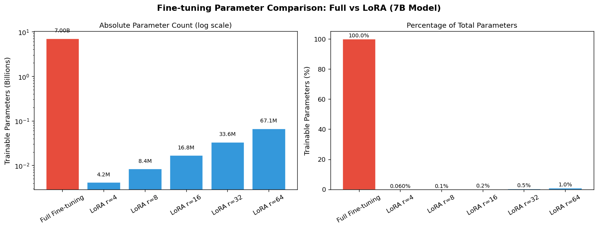

# 6.2 微调：让 LLM 适配你的任务

**核心问题：** 什么时候用微调？LoRA 是什么？微调和对齐有什么区别？

---

## 微调在 LLM 流程中的位置

第5章介绍了对齐（SFT/RLHF），这里的微调在目标上不同，但技术上都是对预训练模型进行监督学习：

```
预训练（大规模无标注文本）
    ↓ 学到通用语言能力
对齐 SFT（指令-回答对）         ← 第5章：让模型学会对话格式和指令遵循
    ↓ + RLHF 等偏好对齐步骤
通用助手（ChatGPT/Claude）      ← 实际还包括 RLHF 等后续步骤，此处简化
    ↓ 微调（任务特定数据）       ← 本节：让助手适配特定任务
专用模型（医疗问答/代码生成/客服）
```

**区别：**
- **对齐 SFT**（指令微调）：让模型学会"作为助手"的行为模式——对话格式、指令遵循、拒绝有害请求
- **任务微调**（本节）：在通用模型基础上训练特定任务行为，例如输出符合 schema 的 JSON 或遵循团队代码格式

两者技术上相同（都是监督微调），目的不同：前者改变行为模式，后者适配具体任务。

---

## 为什么需要微调

通用 LLM 在特定任务上的局限：

| 问题 | 例子 | 微调的解法 |
|------|------|-----------|
| 输出格式不稳定 | 医疗报告需要固定结构 | 用格式化样本训练 |
| 领域知识不足 | 法律条文、专业术语 | 注入领域数据 |
| 风格不匹配 | 企业客服需要特定语气 | 用风格样本训练 |
| 推理成本高 | 简单任务用大模型浪费 | 微调小模型达到同等效果 |

---

## 全量微调 vs 参数高效微调

### 全量微调（Full Fine-tuning）

更新模型所有参数。

**问题：** GPT-3 有 1750 亿参数，全量微调需要数百张 GPU，成本极高。而且容易**灾难性遗忘**——模型在新任务上变好，但原有能力下降。

### LoRA（Low-Rank Adaptation）

LoRA 冻结原始权重并训练低秩更新矩阵。可训练参数比例取决于 rank 和目标模块；效果应与未微调模型及全量微调基线比较。原理和数学推导见 [第5章 5.4 微调](../05_llm_basics/04_finetuning.md)。

### 其他 PEFT 方法

- **Prefix Tuning**：在输入前加可学习的"前缀向量"
- **Adapter**：在 Transformer 层之间插入小型适配模块
- **QLoRA**：LoRA + 量化，进一步降低显存需求，消费级 GPU 可运行

详见 [扩展：微调工程实践](extensions/finetuning_advanced.md)

---

## 微调需要多少数据

| 任务类型 | 最少数据量 | 推荐数据量 |
|---------|-----------|-----------|
| 格式/风格调整 | 50-200 条 | 500-2000 条 |
| 领域知识注入 | 500-1000 条 | 5000+ 条 |
| 全新能力 | 1000+ 条 | 10000+ 条 |

**数据质量很关键**：少量高质量、覆盖边界情况的样本，通常比大量重复或噪声样本更有价值。

---

## 何时用微调 vs RAG vs Prompt

```
任务需求
    │
    ├─ 需要最新/外部知识？
    │       ↓ 是 → RAG（检索增强）
    │
    ├─ 需要特定格式/风格/领域能力？
    │       ↓ 是 → 微调（LoRA）
    │
    ├─ 通用任务，模型能力足够？
    │       ↓ 是 → Prompt 工程
    │
    └─ 知识 + 格式都需要？
            ↓ → RAG + 微调（组合使用）
```

**实践建议：** 先用 Prompt 工程验证任务可行性；如果问题来自知识缺失，优先考虑 RAG；如果问题来自固定格式、风格或行为不稳定，再考虑微调。微调的成本（数据标注 + 训练 + 评估）只有在瓶颈明确时才值得投入。

---

## 代码实验



*图6.2：7B 模型全量微调 vs LoRA 不同 rank 的可训练参数量对比。左图为绝对参数量（对数坐标），右图为参数占比。LoRA r=8 时参数量仅为全量微调的 0.05%。*

**参考：** LoRA 矩阵分解原理图见第5章实验5.4a（[`code/ch05_llm_basics/lora_visualization.py`](../../code/ch05_llm_basics/lora_visualization.py)）。

**代码文件：** [`code/ch06_llm_applications/finetuning_demo.py`](../../code/ch06_llm_applications/finetuning_demo.py)  
**运行方式：** `python code/ch06_llm_applications/finetuning_demo.py`

---

## 本节小结

- **任务微调** 和 **对齐 SFT** 是不同阶段：前者适配任务，后者改变行为模式
- **LoRA** 通过低秩更新减少可训练参数和适配器存储量
- 微调适合需要稳定学习输出格式、分类边界或任务行为的场景
- 选择策略：Prompt 验证可行性，RAG 解决知识更新，微调解决行为适配，按瓶颈升级

---

**下一节：** [6.3 RAG（检索增强生成）](03_rag.md)
**扩展阅读：** [微调工程实践](extensions/finetuning_advanced.md)（数据格式、工具选型、训练配置）
