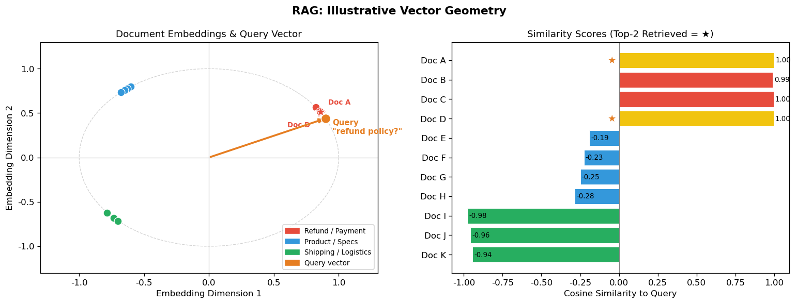

# 6.3 RAG（检索增强生成）

**核心问题：** 如何让 LLM 使用外部知识？

---

## 问题：LLM 的知识是静态的

LLM 的知识来自预训练数据，有两个根本限制：

1. **知识截止日期**：训练完成后，模型不知道新发生的事情
2. **私有知识盲区**：公司内部文档、个人数据从未出现在训练集里

**微调能解决吗？** 微调可以学习领域表达和稳定行为，也可能记住部分训练事实，但不适合作为频繁更新、要求逐条追溯的知识库。对于新闻、产品文档或用户数据，更应评估检索或确定性数据接口。

RAG 的思路是：**不把知识烧进模型，而是在推理时动态检索。**

---

## RAG 的工作流程

```
用户问题："我们公司的退款政策是什么？"
    │
    ▼
[1. 检索] 在知识库里找到相关文档片段
    │      → "退款政策：购买后 30 天内可申请全额退款..."
    ▼
[2. 增强] 把文档片段拼入 Prompt
    │      → "根据以下文档回答问题：\n{文档片段}\n\n问题：{用户问题}"
    ▼
[3. 生成] LLM 根据增强后的 Prompt 生成答案
           → "根据公司政策，您可以在购买后 30 天内申请全额退款..."
```

三个步骤，缺一不可：检索找到相关内容，增强把内容注入上下文，生成产出最终答案。

RAG 的核心风险也对应这三步：
- 检索错：相关文档没有被找出来
- 增强错：检索内容太长、太杂或顺序不合理
- 生成错：模型没有忠实使用检索内容，产生幻觉或遗漏引用

---

## 为什么向量检索有效

RAG 的核心是"找到相关文档"。关键词匹配（搜索"退款"）太脆弱——用户可能问"能不能把钱要回来"，关键词完全不同但语义一样。

**向量检索的思路：** 把文本的语义编码成向量，语义相近的文本对应的向量方向也相近。

这和第 5 章 token embedding 共享“把离散对象映射到向量空间”的思想，但粒度、训练目标和使用方式不同。RAG 通常使用专门的文本或多模态检索模型，不能直接把语言模型的 token embedding 当作文档检索向量：

```
第5章：token embedding
  "king" → [0.2, 0.8, ...]
  "queen" → [0.3, 0.7, ...]   ← 方向相近，语义相关

RAG：文档 embedding（同样的思想，粒度更大）
  "退款政策：30天内全额退款" → [0.1, 0.9, ...]
  "能不能把钱要回来？"       → [0.15, 0.85, ...]  ← 方向相近，语义相关
```

**余弦相似度：** 衡量两个向量方向的接近程度，值域 [-1, 1]，越接近 1 越相似。

```
相似度 = cos(θ) = (向量A · 向量B) / (|A| × |B|)
```

实际使用时，把知识库里所有文档都编码成向量存好，查询时把用户问题也编码成向量，找余弦相似度最高的几个文档——这就是向量检索。

---

## 分块策略：为什么不把整篇文档塞进去

**直觉：** 如果用户问退款政策，把整本产品手册（100页）塞进 Prompt，有两个问题：

1. **占用上下文预算**：模型、服务配置和成本预算都会限制可用输入长度
2. **检索精度下降**：文档越长，向量越"平均"，语义越模糊，找到的文档越不准

**实践做法：** 把文档切成可检索的块，分别编码存储。块大小没有通用固定值，应根据文档结构、问题粒度、embedding 模型和生成上下文预算，通过检索评估与端到端评估共同选择。

```
原始文档（1000 tokens）
    ↓ 分块
块1（300 tokens）：产品介绍
块2（300 tokens）：退款政策    ← 用户问退款，只检索到这块
块3（400 tokens）：联系方式
```

块太小：上下文不完整，答案可能缺少背景。块太大：检索精度下降。这是 RAG 工程中需要调整的核心参数之一。

实际系统还需要考虑：
- 是否保留标题、章节路径和时间戳等元数据
- 是否对检索结果做重排序
- 是否让模型在回答中引用来源
- 当检索置信度低时是否拒答或转人工

---

## RAG vs 微调：如何选择

| 场景 | 推荐方案 | 原因 |
|------|---------|------|
| 知识频繁更新（新闻、产品文档） | RAG | 更新知识库即可，无需重训 |
| 私有数据（内部文档、用户数据） | 受控 RAG 或数据接口 | 可独立更新和做权限过滤，但仍需保护索引、日志与检索结果 |
| 需要引用来源、便于核验 | RAG | 可以返回检索来源；引用存在不代表结论必然正确 |
| 输出格式/风格要求严格 | 微调 | RAG 不改变模型行为 |
| 领域表达、分类边界或稳定行为不足 | 微调 | 需要改变模型在固定任务上的行为 |
| 两者都需要 | RAG + 微调 | 微调固定格式，RAG 提供知识 |

**实践建议：** 若失败来自缺少外部证据，可先做最小检索基线，并分别测量召回、排序和生成忠实度；若失败来自稳定行为，再比较 Prompt 或微调。RAG 与微调的成本高低取决于数据、基础设施和验收要求，不能只按技术名称排序。

---

## 代码实验



*图6.3：手工构造的二维 embedding 几何示意。左图让退款、产品、配送三类向量形成可见簇，右图展示余弦相似度；它不来自真实 embedding 模型或评测集。脚本中的可运行检索器则使用字符 n-gram 计数向量，作为词法基线，与语义 embedding 检索不是同一方法。*

**代码文件：** [`code/ch06_llm_applications/rag_demo.py`](../../code/ch06_llm_applications/rag_demo.py)  
**运行方式：** `python code/ch06_llm_applications/rag_demo.py`

---

## 本节小结

- RAG 通过“检索 + 上下文组装 + 生成”让模型在回答时使用外部证据，但不会自动保证召回和忠实度
- 检索 embedding 与 token embedding 共享向量表示思想，但使用不同粒度和训练目标
- 分块是 RAG 的关键工程决策：块太小上下文不完整，块太大检索精度下降
- RAG 的主要失败模式来自检索召回不足、上下文拼接不当和生成阶段不忠实
- RAG 适合知识频繁更新、需要引用来源的场景；微调适合格式/风格/专业能力要求严格的场景

---

**下一节：** [6.4 Agent 框架](04_agent.md)
**扩展阅读：** [RAG 系统深度优化](extensions/rag_advanced.md)（混合检索、重排序、分块策略进阶、RAGAS 评估）
