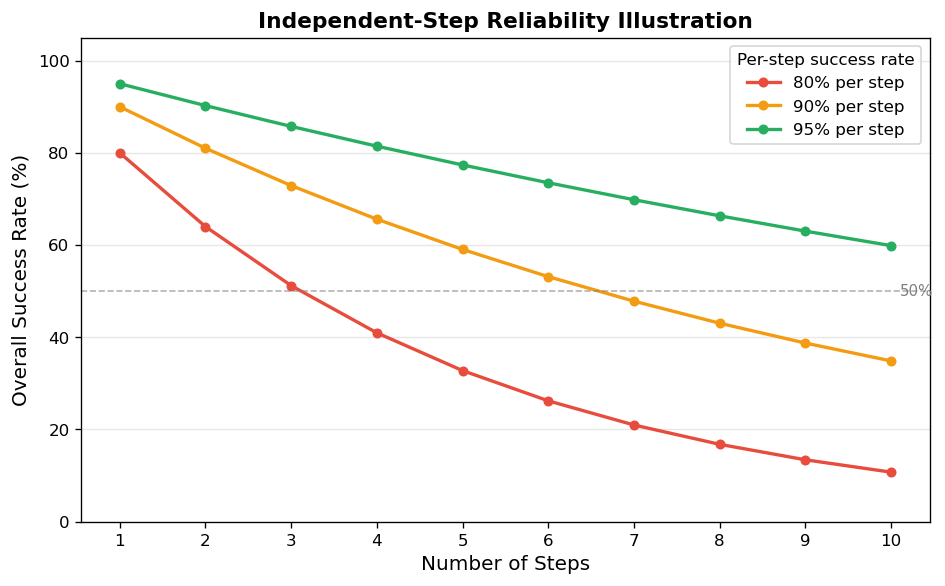

# 6.4 Agent 框架

**核心问题：** 如何让 LLM 能调用工具和规划？

---

## 问题：模型输出不等于外部动作

基础 LLM 产生 token 或结构化调用请求；真正的查询、计算和写操作由模型外的程序执行。即使接口支持 tool calling，也必须由应用负责参数校验、权限检查、执行与结果回传。

- 问"今天天气怎么样"——它只能根据训练数据猜测，无法查询实时天气
- 问"帮我计算这个积分"——它可能算错，因为它是在"预测文字"而不是"真正计算"
- 问"帮我发一封邮件"——它能写邮件内容，但无法真正发送

如果工具调用顺序固定，普通工作流通常更简单、可测。只有当下一步工具和参数需要根据中间结果动态选择时，才需要 Agent 式循环。

---

## ReAct：计划、行动与观察

Agent 的核心模式叫 **ReAct**（Reason + Act），每一步分三个阶段：

```
[Plan]    模型根据当前状态选择下一步
    ↓
[Act]     调用工具，执行操作
    ↓
[Observe] 观察工具返回的结果
    ↓
回到 [Plan]，根据新信息继续规划
    ↓
重复，直到得出最终答案
```

ReAct 强调交替进行 reasoning 与 acting。工程实现不必暴露完整内部思维链，应记录可审计的动作理由、工具参数、工具结果和终止原因。

借用控制论里的反馈概念，Agent 不是一次性生成答案，而是一个简单的反馈闭环：

```text
观察当前状态 → 规划下一步 → 执行动作 → 接收反馈 → 修正计划
```

反馈闭环的价值是能根据外部结果修正行为；代价是每多一次循环都会增加延迟、成本和失败概率。因此生产系统不能只追求“Agent 更自主”，还要限制步数、约束工具权限，并为错误反馈设计回退路径。

**一个具体例子：**

```
问题："订单 A 是否符合延迟补偿条件？如果符合，准备补偿申请。"

Step 1:
  Plan    → "先查询订单状态"
  Act     → get_order("A")
  Observe → "已延迟 6 天，商品类别为预售"

Step 2:
  Plan    → "补偿条件取决于预售规则，查询对应政策"
  Act     → search_policy("预售 延迟补偿")
  Observe → "延迟超过 5 天可申请，但需要用户确认"

Step 3:
  Plan    → "写操作有副作用，先请求用户确认"
  Answer  → "订单符合条件。是否提交补偿申请？"
```

---

## 工具定义：描述质量决定调用准确率

工具的 `description` 字段是 LLM 决策的依据。描述越精确，LLM 越能选对工具：

```python
# ❌ 描述模糊，LLM 可能误用
{"name": "search", "description": "搜索信息"}

# ✅ 描述精确，包含适用场景和不适用场景
{
    "name": "search",
    "description": "在知识库中搜索概念定义和技术原理。"
                   "适用于：查找定义、了解背景知识。"
                   "不适用于：实时数据、数值计算。"
}
```

**三要素：** 做什么 + 什么时候用 + 什么时候不用。缺少后两条，LLM 容易在不该调用时调用，或在该调用时选错工具。

---

## 为什么 Agent 容易出错

Agent 的可靠性问题之一是**错误累积**。作为简化示例，若每一步独立、成功率都为 90%，并且所有步骤都必须成功，则：

| 任务步数 | 整体成功率 |
|---------|-----------|
| 1 步 | 90% |
| 3 步 | 73% |
| 5 步 | 59% |
| 10 步 | 35% |

**计算方式：** 整体成功率 = 单步成功率 ^ 步数。真实系统中的步骤通常不独立，重试、校验和替代路径也会改变结果，因此这张表用于说明风险方向，不是 Agent 的通用可靠性预测。

这意味着：
- 固定步骤优先写成确定性工作流，只让模型处理确实需要判断的节点
- 多步骤任务需要逐步校验、有限重试、超时、幂等和终止条件
- 拆成多个 Agent 不会自动提高可靠性；如果仍然串行依赖，错误依旧可能累积

---

## Agent 的适用边界

**适合 Agent 的场景：**
- 下一步动作必须根据工具返回结果动态决定
- 可用工具较多，无法预先固定完整调用路径
- 任务允许校验、重试、回退或人工接管

**不适合 Agent 的场景：**
- 调用顺序固定，可用普通函数或工作流编排完成
- 任务可以一次性生成（直接用 Prompt 更简单）
- 对可靠性要求极高（Agent 的不确定性难以消除）
- 工具调用有副作用且不可撤销（删除文件、发送消息）

**实践建议：** 先区分“需要工具”和“需要 Agent”。实时查询、计算或 API 调用可以由确定性程序完成；只有动态决策确实带来收益时，才引入模型控制的循环。

生产系统中还需要额外约束：
- 高风险工具需要权限校验和人工确认
- 所有工具调用都要记录输入、输出和耗时
- 可撤销操作优先于不可撤销操作
- 失败时要有重试、回退或转人工路径

---

## 代码实验



*图6.4：在“步骤独立、单步成功率固定、全部步骤都必须成功”的示意假设下，任务成功率会随步数下降。该图用于解释错误累积，不代表真实 Agent 的通用基准。*

**代码文件：** [`code/ch06_llm_applications/agent_demo.py`](../../code/ch06_llm_applications/agent_demo.py)  
**运行方式：** `python code/ch06_llm_applications/agent_demo.py`

代码中的算术工具只允许数字和基本运算，不使用 `eval` 执行任意表达式；LoRA 参数示例也按层数、矩阵维度、目标模块和 rank 计算，不使用固定百分比。

---

## 本节小结

- Agent 让 LLM 通过工具调用突破"只能生成文本"的限制
- **ReAct 模式**：先推理（Reason）再行动（Act），根据观察结果（Observe）循环迭代
- Agent 可以看作一个反馈闭环，但反馈越多，延迟、成本和错误累积风险也越高
- 工具描述、schema、示例和运行时校验共同影响调用可靠性
- Agent 的核心风险是**错误累积**：步骤越多，整体可靠性越低
- 适合多步骤、依赖实时数据的任务；不适合对可靠性要求极高或有不可撤销副作用的场景
- 生产环境必须控制权限、记录工具调用，并为失败路径设计回退机制

---

**下一节：** [6.5 LLM 系统设计](05_system_design.md)
**扩展阅读：** [Agent 框架深度](extensions/agent_advanced.md)（工具可靠性、多步推理控制、主流框架选型）
