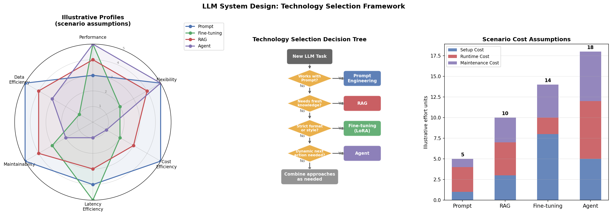

# 6.5 LLM 系统设计

**核心问题：** 面对一个实际任务，如何选择技术路线？如何把 Prompt、RAG、微调、Agent 组合起来？

---

## 四条路线的本质

学完 6.1-6.4 后，你手里有四种工具：

| 工具 | 本质 | 改变了什么 |
|------|------|-----------|
| Prompt 工程 | 指令设计 | 不改模型，改输入 |
| 微调 | 参数更新 | 改变模型行为 |
| RAG | 检索增强 | 扩展知识边界 |
| Agent | 工具调用 | 扩展行动能力 |

**核心原则：先定位瓶颈，再选择最小充分方案。** Prompt 适合澄清任务；RAG、微调和 Agent 分别处理外部证据、稳定行为和动态行动，不构成固定升级顺序。

---

## 技术路线选择

### 决策树

```
你的任务是什么类型？
│
├─ 需要访问外部知识库或最新信息？
│   └─ YES → RAG
│       （知识会更新、数据量大、需要引用来源）
│
├─ 需要特定的输出格式、风格或专业领域行为？
│   └─ YES → 微调
│       （有足够标注数据、格式要求严格、通用模型效果差）
│
├─ 需要调用外部工具或执行多步骤操作？
│   └─ YES → Agent
│       （搜索、计算、API 调用、自动化任务）
│
└─ 任务通用，模型已有足够能力？
    └─ YES → Prompt 工程
        （快速验证、预算有限、任务多变）
```

### 常用方法对比

| 维度 | Prompt 工程 | RAG | 微调 | Agent |
|------|------------|-----|------|-------|
| 启动成本 | 通常较低，但受评估与上下文影响 | 取决于语料、索引、权限和评估 | 取决于数据、训练和模型运维 | 取决于工具数量、权限和失败处理 |
| 知识更新 | 依赖输入 | 快（更新知识库） | 慢（需重新训练） | 依赖工具 |
| 可解释性 | 中 | 高（可追溯来源） | 低 | 取决于日志和工具结果 |
| 主要风险 | 指令不稳 | 检索失败 | 数据质量和过拟合 | 错误累积、权限和成本 |
| 典型用例 | 摘要、翻译 | 企业知识库问答 | 代码补全、特定风格 | 自动化流程、工具操作 |

**实践建议：** 大多数项目应从 Prompt 工程开始，验证可行性后再考虑 RAG 或微调。过早引入复杂方案是常见的工程陷阱。

---

## 三种架构模式

### 模式一：简单问答

**适用：** 通用对话、客服机器人、内容生成

```
用户输入
    │
    ▼
[Prompt 构建]
（System Prompt + 历史对话 + 用户输入）
    │
    ▼
[LLM 推理]
    │
    ▼
模型输出 → 用户
```

**特点：** 架构简单，延迟低，适合快速上线。主要挑战是 Prompt 工程和对话历史管理。

### 模式二：RAG 问答

**适用：** 企业知识库、文档问答、需要引用来源的场景

```
用户输入
    │
    ├──→ [Embedding 模型] → 查询向量
    │                           │
    │                    [向量数据库检索]
    │                           │
    │                    相关文档片段
    │                           │
    ▼                           ▼
[Prompt 构建] ←─────────────────┘
（System Prompt + 检索内容 + 用户输入）
    │
    ▼
[LLM 推理] → 带引用的回答 → 用户
```

**特点：** 知识可更新，回答可溯源。主要挑战是检索质量和上下文长度管理。

### 模式三：Agent 工作流

**适用：** 多步骤推理、调用外部工具、自动化任务执行

```
用户输入
    │
    ▼
[LLM 规划]（分析任务，决定调用哪些工具）
    │
    ├──→ 工具调用 1（搜索、计算、API...）→ 结果 1
    │
    ├──→ 工具调用 2（基于结果 1 决策）→ 结果 2
    │
    ▼
[LLM 整合]（综合所有工具结果）
    │
    ▼
最终回答 → 用户
```

**特点：** 能力强，可完成复杂任务。主要挑战是可靠性、成本（多轮 LLM 调用）和延迟。

---

## 实战案例

### 案例1：企业客服机器人

**需求：** 回答客户问题，需要查询订单状态和政策文档。

**方案：** RAG + Agent 组合

```
用户问题
    │
    ├──→ RAG 检索政策文档
    ├──→ Agent 调用订单查询 API
    │
    ▼
LLM 整合 → 回答
```

**选择理由：** 政策文档适合 RAG（知识量大、需要引用）；订单状态来自实时 API。若查询路径固定，可使用确定性 API 工作流；只有处理路径需要随结果变化时才引入 Agent。

### 案例2：代码生成助手

**需求：** 根据需求生成符合团队规范的代码。

**方案：** 微调 + RAG 组合

```
用户需求
    │
    ├──→ RAG 检索内部代码示例
    │
    ▼
微调后的模型（已学习团队代码风格）
    │
    ▼
符合规范的代码
```

**选择理由：** 代码风格和规范适合微调（格式固定、有大量样本）；内部代码库适合 RAG（持续更新）。

### 案例3：数据分析助手

**需求：** 用户提问，系统自动查询数据库并生成分析报告。

**方案：** Agent（主）+ Prompt 工程（辅）

```
用户问题
    │
    ▼
Agent 规划
    ├──→ 调用 SQL 查询工具
    ├──→ 调用数据分析工具
    │
    ▼
LLM 生成报告（Prompt 定义报告格式）
```

**选择理由：** 数据查询和分析需要工具，但不必天然采用 Agent。固定报表可用参数化 SQL 和确定性流水线；探索式问题需要根据中间结果选择查询时，再考虑 Agent。报告格式可先通过 Prompt 和 schema 约束控制。

---

## 模型选择框架

不推荐具体模型（迭代快，推荐会过时），给出选择维度：

| 维度 | 考量 |
|------|------|
| 任务复杂度 | 简单分类/提取 → 小模型；多步推理/代码 → 大模型 |
| 延迟要求 | 分别测量 TTFT、生成速度和端到端分位数，再选择模型与部署方式 |
| 数据隐私 | 根据数据分类、保留策略、部署地域、访问控制和供应商协议判断 |
| 成本预算 | 用真实输入/输出长度、并发、利用率和运维成本计算 API 与自部署的盈亏点 |

---

## 部署选项

| 方案 | 适合场景 | 主要权衡 |
|------|---------|---------|
| 托管 API | 快速验证、请求量不稳定 | 需核对数据处理边界、限额、价格和供应商可用性 |
| 云 GPU 自部署 | 数据合规要求、规模大 | 运维复杂，需要 MLOps 能力 |
| 混合方案 | 按数据等级或任务路由 | 路由、审计和故障处理更复杂；收益需按真实流量测量 |

---

## 决策检查清单

在确定方案前，回答以下问题：

- [ ] 是否先用最简单的方案（Prompt + API）验证了可行性？
- [ ] 知识是否需要频繁更新？（是 → 优先 RAG，不是 → 考虑微调）
- [ ] 标注数据是否覆盖目标输入、边界条件和失败场景，并留出独立验证集？
- [ ] 数据是否有合规要求？（能否发送给第三方 API）
- [ ] 团队是否有运维能力？（自部署需要 MLOps）
- [ ] 月度预算上限是多少？
- [ ] 失败时是否有降级、回退或人工接管路径？
- [ ] 是否定义了质量、延迟、成本和安全指标？

---

## 本节小结

- **最小充分方案**：先用 Prompt 澄清任务，再按外部证据、稳定行为或动态行动的实际瓶颈选择方案
- **RAG vs 微调**：知识需要更新选 RAG，格式/风格要求严格选微调，两者不互斥
- **Agent 的代价**：能扩展行动能力，但成本、延迟、可靠性都是挑战，不要过早引入
- **部署选型**：从 API 或托管服务开始验证，规模化后再评估自部署的必要性
- **生产底线**：上线前必须定义评估集、监控指标、回退策略和成本上限

---

**扩展阅读：** [E6 推理部署优化](extensions/inference_deployment.md)

**下一章：** [第7章：多模态 LLM](../07_multimodal_llm/README.md)

---

## 代码实验



*图6.5：基于一组显式教学假设的技术路线示意。左图和右图使用任意单位展示可能的能力与成本差异，不是实测排名；中图强调先定位瓶颈，并区分固定工具流程与需要动态决策的 Agent。*

**代码文件：** [`code/ch06_llm_applications/system_design_demo.py`](../../code/ch06_llm_applications/system_design_demo.py)  
**运行方式：** `python code/ch06_llm_applications/system_design_demo.py`
