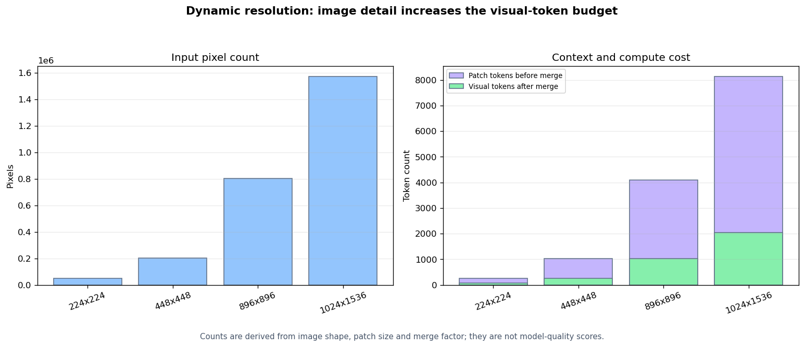

# 7.3 高分辨率多模态架构

**核心问题：** 图像如何变成语言模型可处理的 token，高分辨率又增加了什么成本？

---

## 通用结构

以 Qwen-VL、LLaVA 等模型为例，多模态生成系统通常包含：

```text
图像
  → 视觉预处理与 patch 划分
  → 视觉编码器
  → 投影或视觉 token 压缩
  → 与文本 token 组成序列
  → 语言模型生成输出
```

不同模型在视觉编码器、位置表示、动态分辨率、token 压缩和训练阶段上不同。具体实现应以锁定版本的配置和模型说明为准，而不是根据系列名称推断。


*图 7.3-1：固定缩放与动态分辨率两种输入路径。读图时关注视觉 token 如何产生和进入语言模型，不把示意结构当作具体版本的完整实现。*

## 动态分辨率

固定把所有图像缩放到同一正方形，便于批处理，但可能拉伸宽高比或丢失小文字。动态分辨率根据原图尺寸选择 patch 网格，能够保留更多细节，同时使视觉 token 数随图像面积增加。

若 patch 大小为 $p$，图像高宽为 $H,W$，未压缩 patch 数近似为：

$$
N_{patch}=\left\lceil\frac{H}{p}\right\rceil
\left\lceil\frac{W}{p}\right\rceil
$$

若再以 $m\times m$ 的空间合并减少 token，数量近似为：

$$
N_{visual}=\left\lceil\frac{\lceil H/p\rceil}{m}\right\rceil
\left\lceil\frac{\lceil W/p\rceil}{m}\right\rceil
$$

视觉 token 会占用上下文、KV cache 和注意力计算。更高分辨率是否改善任务，取决于文字或目标尺寸、预处理、训练数据和模型能力，不能由像素数直接推出。

## 投影与 token 压缩

视觉编码器输出维度通常与语言模型隐藏维度不同，因此需要投影：

$$
V\in\mathbb R^{N_v\times d_v}
\quad\xrightarrow{f_{proj}}\quad
Z\in\mathbb R^{N'_v\times d_{model}}
$$

线性层、MLP、空间合并和查询聚合都可以承担部分转换。主要取舍是：

- $N'_v$ 越小，上下文和推理成本越低；
- 压缩越强，小文字、坐标和局部目标越可能丢失；
- 投影容量越大，训练参数与过拟合风险也会变化。

## 多图与视频

多图输入需要显式保留图像边界和顺序，否则模型可能混淆“图 1”和“图 2”。视频还需要时间位置或帧顺序信息。

系统应记录每张图像的缩放、裁剪、帧采样和视觉 token 数。只记录原始分辨率不足以复现实验。

## 融合位置


*图 7.3-2：早期、晚期和中间融合在信息交互位置上的差异。融合更早会增加跨模态交互，也通常增加序列和计算成本。*

| 方式 | 交互位置 | 主要限制 |
|---|---|---|
| 早期融合 | 输入或浅层即合并 | 联合序列长、计算高 |
| 晚期融合 | 各模态先独立编码 | 深层交互有限 |
| 中间融合 | 通过投影、查询或交叉注意力连接 | 结构和训练更复杂 |

这些是分析框架，不是固定优劣排序。

## 代码实验



*图 7.3-3：在固定 patch 和空间合并设置下，输入像素增加会提高 patch 与视觉 token 数。图中只计算资源预算，不表示模型准确率。*

**代码文件：** [`code/ch07_multimodal_llm/qwen_vl_analysis.py`](../../code/ch07_multimodal_llm/qwen_vl_analysis.py)

```bash
python code/ch07_multimodal_llm/qwen_vl_analysis.py
```

修改 `patch_size`、`merge_size` 或图像形状，比较视觉 token 数。完成标准是能够解释细节保留与上下文成本之间的关系。

---

## 本节小结

- 多模态模型把视觉编码结果投影或压缩为语言模型可处理的 token。
- 动态分辨率保留更多原图结构，也会增加视觉 token 和推理成本。
- 模型质量必须在具体任务上评估，不能从分辨率或模型名称直接推断。

---

**下一节：** [7.4 高分辨率图像处理](03_high_resolution.md)
