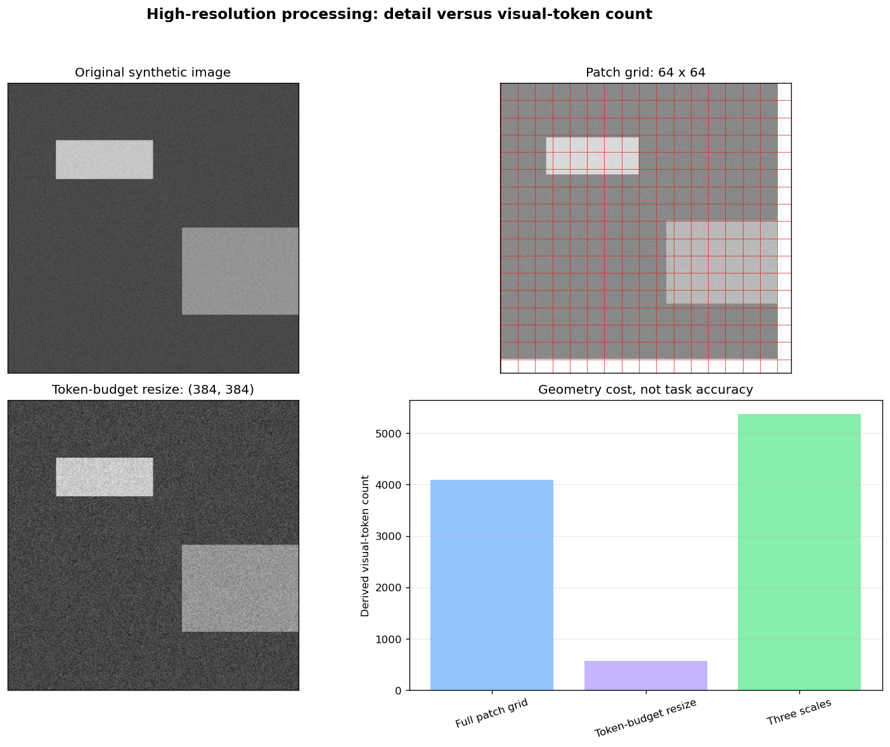

# 7.4 高分辨率图像处理

**核心问题：** 如何保留小文字和局部目标，同时控制视觉 token 数？

---

## 分辨率为什么影响成本

若高宽同时放大 $k$ 倍，像素与 patch 数近似增加 $k^2$ 倍。视觉 token 随之占用更多上下文、KV cache 和注意力计算。

分辨率不是越高越好：大面积背景可能只增加成本，缩放或分块也可能破坏全局布局。应根据最小目标尺寸和任务指标选择处理方式。

## 方式一：保持宽高比缩放

将图像缩放到允许的像素或 token 区间，同时保持宽高比，并对边缘补齐。

优点是实现简单、只产生一个视图；缺点是长文档或全景图仍可能把文字缩得过小。

## 方式二：分块

把图像切为多个局部块，必要时增加重叠，并保留一张低分辨率全局图：

```text
原图
  ├─ 全局缩略图：保留页面与物体关系
  └─ 局部块：保留文字、小目标和边缘细节
```

重叠区域能降低目标被边界截断的风险，但会产生重复 token。拼接视觉 token 时还要保留块的位置和顺序。


*图 7.4-1：全局缩略图与局部块共同输入。应检查块边界、重叠比例和位置标记，而不只统计块数。*

## 方式三：动态 token 预算

根据原图宽高比选择 patch 网格，并限制最小、最大视觉 token 数。它避免所有图像固定成同一正方形，但同一 batch 中序列长度不同，会增加 padding 和调度复杂度。


*图 7.4-2：不同宽高比映射到不同 patch 网格。网格越密，细节保留与上下文成本通常都越高。*

## 方式四：多尺度或区域采样

多尺度输入同时处理全局和局部视图；区域采样先定位可能相关区域，再提高局部分辨率。它们可以减少无关背景，但依赖区域检测或任务先验，漏掉的区域无法在后续恢复。

## 选择与验证

| 场景 | 可先尝试 | 必查问题 |
|---|---|---|
| 普通照片问答 | 保持比例缩放 | 小目标是否仍可见 |
| 文档和图表 | 全局图 + 重叠分块 | 字符、坐标和跨块表格 |
| 多图输入 | 每图 token 上限 | 图像顺序和总上下文 |
| 低延迟系统 | 动态预算或区域采样 | 漏检与长尾延迟 |

比较方案时固定模型、数据和提示词，并记录：

- 原图与处理后尺寸；
- patch 网格、块数、重叠和视觉 token；
- 任务质量及按目标尺寸分组的错误；
- 预处理、模型推理和端到端延迟；
- 峰值显存与失败样本。

没有这些条件的“准确率提升”和“延迟倍数”不能作为通用结论。

## 代码实验



*图 7.4-3：原图、patch 网格、token 预算缩放和多尺度方案的几何成本。柱状图是由网格计算出的 token 数，不是模型准确率或实测延迟。*

**代码文件：** [`code/ch07_multimodal_llm/high_resolution_processing.py`](../../code/ch07_multimodal_llm/high_resolution_processing.py)

```bash
python code/ch07_multimodal_llm/high_resolution_processing.py
```

修改原图尺寸、patch 大小和目标 token 数，比较处理结果。若要得出任务结论，还需接入真实模型和标注数据。

---

## 本节小结

- 高分辨率的主要代价来自视觉 token，而不只是原始文件大小。
- 缩放、分块、动态预算和区域采样各自保留不同信息。
- 方案选择需要同时报告细节任务指标、token、延迟和显存。

---

**下一节：** [7.5 多模态应用与指标](04_applications.md)
