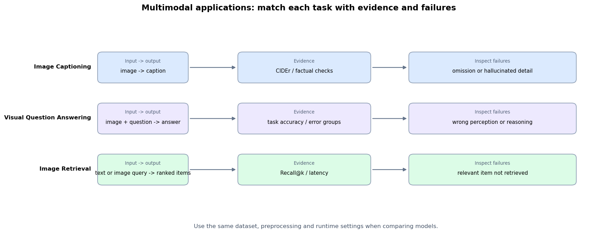

# 7.5 多模态应用与指标

**核心问题：** 图像描述、视觉问答和图像检索分别输出什么，又该如何评价？

---

## 图像描述

图像描述把视觉 token 与已生成文本共同输入解码器，逐 token 产生描述。

```text
图像 → 视觉表示 → 投影 / 压缩
                    + 文本前缀
                         ↓
                   自回归描述
```

BLEU、METEOR 和 CIDEr 等指标比较生成文本与参考描述，但同一图像可以有多种正确说法。自动指标之外，还应检查不存在对象、遗漏、文字数字和空间关系错误。

## 视觉问答

视觉问答输入图像与问题，输出文本答案。错误可以分为：

```text
感知错误：没有识别对象、文字或位置
对齐错误：问题没有对应到正确图像区域
推理能力错误：感知正确，但计算或结论错误
```

开放式 VQA 可以使用准确率、规范化匹配或人工评价；文字密集任务还应单独报告 OCR 相关错误。高分辨率可能改善小文字可见性，但也增加视觉 token，且不能自动修复推理能力错误。

医疗、工业等高风险应用必须使用领域数据、明确错误代价和人工复核，不能从通用 VQA 分数推断可用性。

## 图像检索

双编码器分别生成查询与图像向量，并按相似度排序：

$$
\operatorname{cos}(\mathbf q,\mathbf v)=
\frac{\mathbf q^{\mathsf T}\mathbf v}
{\lVert\mathbf q\rVert_2\lVert\mathbf v\rVert_2}
$$

如果训练和索引使用归一化向量，余弦相似度等价于归一化向量点积。并非所有模型输出都天然满足“模长无意义”，应按模型训练方式和索引配置处理。

检索常报告 Recall@k，也应记录索引规模、查询延迟、语言/类别分组和失败样本。多模态 RAG 还要检查召回内容是否真正支撑最终回答。

## 三类任务不能共用一个分数

| 任务 | 输入 → 输出 | 主要指标 | 必查错误 |
|---|---|---|---|
| 图像描述 | 图像 → 文本 | CIDEr 类指标、事实核验 | 幻觉、遗漏、属性错误 |
| 视觉问答 | 图像 + 问题 → 答案 | 任务准确率、分组错误率 | 感知、对齐、推理能力错误 |
| 图像检索 | 查询 → 排序列表 | Recall@k、MRR、延迟 | 相关项漏召回、偏置 |

比较模型时固定数据集版本、图像预处理、提示词、解码参数和硬件条件。

## 代码实验



*图 7.5-1：三类应用从输入输出定义落到指标和失败模式。图中不包含模型排名；它用于设计评测记录。*

**代码文件：** [`code/ch07_multimodal_llm/multimodal_applications.py`](../../code/ch07_multimodal_llm/multimodal_applications.py)

```bash
python code/ch07_multimodal_llm/multimodal_applications.py
```

---

## 本节小结

- 图像描述、VQA 和检索的输出不同，不能用同一指标比较。
- 自动指标需要配合错误分类和原始样本复核。
- 分辨率、视觉 token 和任务质量应在同一实验配置下共同记录。

---

**扩展阅读：** [多模态系统组合](extensions/multimodal_applications_advanced.md)
**下一节：** [7.6 多模态案例与评测](05_case_studies.md)
