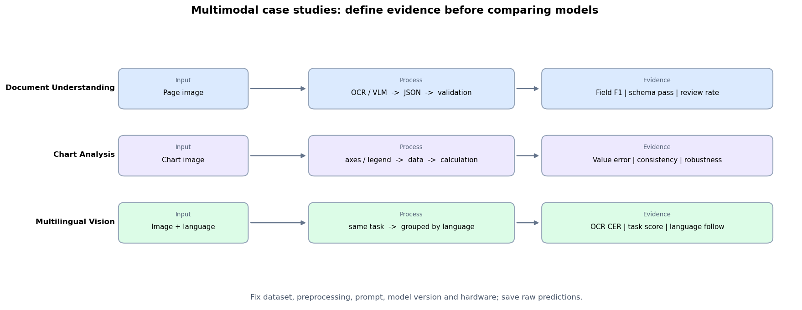

# 7.6 多模态案例与评测

**核心问题：** 文档、图表和多语言图像任务应如何拆解与验收？

---

## 案例 1：文档字段提取

目标是从发票、合同或报告图像中提取日期、金额、主体名称和表格等结构化信息。

### 处理流程

```text
文档图像
  → 方向与清晰度检查
  → OCR 或多模态模型
  → 按 schema 输出 JSON
  → 类型、范围和字段间关系校验
  → 人工复核低置信度结果
```

主要错误来源包括小字号、扫描倾斜、版式变化、相似字符和跨页表格。固定使用某个输入分辨率并不能保证字符可读，应根据原图尺寸、文字大小和模型的图像处理方式测试。

### 评测

- 字段级精确率、召回率和 F1；
- 金额、日期等字段的严格匹配率；
- JSON schema 通过率；
- 按模板、语言和扫描质量分组的错误率；
- 单页延迟、峰值显存与人工复核比例。

不要只计算整份文档准确率。它无法指出错误集中在哪个字段，也不利于决定使用 OCR、提示词还是规则校验修复。

---

## 案例 2：图表数据提取

图表任务可以拆成四步：识别图表类型与坐标轴、读取图例、提取数据点、根据提取结果计算或描述。先保存结构化数据，再生成文字结论，便于逐步定位错误。

```json
{
  "chart_type": "line",
  "x_axis": ["2022", "2023", "2024"],
  "series": [{"name": "sales", "values": [120, 145, 151]}],
  "unit": "万元"
}
```

### 评测

- 坐标轴、图例和单位识别准确率；
- 数据点的绝对误差或相对误差；
- 趋势、极值等结论是否与已提取数据一致；
- 裁剪、压缩、颜色变化和密集刻度下的鲁棒性。

模型可能给出流畅但数值错误的解释。对高风险场景，应由程序根据结构化数据计算增幅、极值和趋势，不直接采用自由文本中的数字。

---

## 案例 3：多语言图像理解

多语言任务同时受到图中文字识别、文本分词、训练数据分布和输出语言控制的影响。不能根据模型名称推断某种语言一定更好。

评测集应对各语言使用相同任务模板和难度，并分别报告：

- 图中文字转写准确率；
- 问答或字段提取指标；
- 输出语言遵循率；
- 混合语言、专有名词和数字的错误类型。

系统提示可以指定输出语言，但不会补足模型缺少的文字识别或领域能力。必要时可以组合语言专用 OCR、翻译和多模态模型，并记录每一步的误差。

---

## 用同一套实验比较方案

比较两个模型或两种图像处理方法时，至少固定：

```text
评测样本与分组
模型和推理框架版本
输入缩放、裁剪与压缩方式
提示词和解码参数
硬件、并发和预热设置
失败重试与后处理规则
```

报告样本数、指标定义和置信区间。没有这些信息的百分比不应作为模型优劣结论。

---

## 代码实验



*图 7.6-1：文档、图表和多语言任务分别从输入进入处理流程，并落到可检查的验收指标。比较模型前还需要固定数据、预处理、提示词、版本和硬件。*

**代码文件：** [`code/ch07_multimodal_llm/case_studies.py`](../../code/ch07_multimodal_llm/case_studies.py)  
**运行方式：** `python code/ch07_multimodal_llm/case_studies.py`

脚本不再内置模型分数。填入真实评测结果时，应同时保存原始预测和评测配置。

---

## 本节小结

- 文档任务需要字段级指标、结构校验和错误分组。
- 图表任务应先提取数据，再由可检查的计算产生结论。
- 多语言能力必须逐语言评测，不能从模型品牌或提示语言推断。
- 模型比较必须说明数据、版本、预处理、指标与运行环境。

---

**返回：** [第 7 章：多模态 LLM](README.md)
