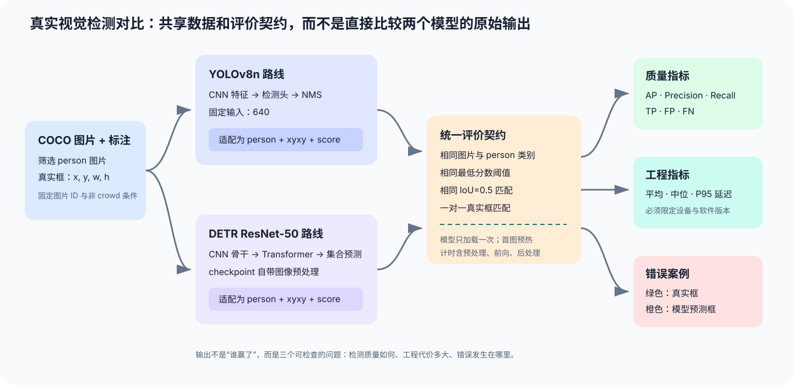

# 视觉目标检测方法对比

**阶段：** 第一阶段  
**对应章节：** 第 3 章深度学习、第 4 章Transformer、第 8 章LLM工程实践  
**状态：** 真实权重 smoke test 与固定 50 张 COCO val2017 教学基准均已通过

## 项目目标

在同一目标检测任务上比较传统视觉深度学习路线与 Transformer 路线，回答：

> YOLO 和 DETR 如何表示图像、定位目标、处理全局关系，并在精度、速度和部署复杂度之间取舍？

项目不是简单比较模型排行榜，而是围绕一条信息处理链展开：

```text
图像表示 → 特征提取 → 目标定位 → 类别判决 → 误检/漏检分析 → 工程评估
```



*项目流程图：同一批真实图片分别进入 YOLO 和 DETR，模型输出先转换成统一的 `person + xyxy + score` 契约，再计算质量、延迟和错误案例。图中的核心不是让两条模型路线完全相同，而是让数据、类别、阈值、匹配与计时口径可以检查。*

## 第一版范围

第一版先完成推理和分析，不要求从头训练大型模型：

- 选择一个小规模、类别有限的检测数据子集；
- 选择一个 YOLO 基线和一个 DETR 基线；
- 统一输入、类别和评价方式；
- 比较检测精度、推理延迟和资源消耗；
- 分析小目标、遮挡、密集目标和背景干扰下的错误；
- 输出一张方法对比主图和一份结论报告。

现有代码可作为前置实验或概念基线：

- `code/ch03_deep_learning_fast/detection_segmentation_demo.py`
- `code/ch03_deep_learning_fast/mnist_cnn.py`
- `code/ch04_transformer/self_attention.py`
- `code/ch04_transformer/causal_mask_demo.py`

YOLO 和 DETR 已通过独立适配器接入同一个模型无关评价层。`evaluate.py` 统一使用相同的框坐标、类别、置信度、IoU 阈值和一对一匹配规则，避免出现“评价口径不同却比较结果”的问题。默认测试不下载模型或数据，因此不会用合成分数冒充实测结果。

## 实际对比配置（已固定）

- **数据：** 用户提供的 COCO validation 标注和图片目录；默认选择含 `person` 的前 50 张非 crowd 图像；
- **模型：** YOLOv8n 与 `facebook/detr-resnet-50@main`；DETR 强制使用官方 safetensors 权重，避免旧 `.bin` 权重在低版本 PyTorch 上的反序列化风险；
- **任务：** 单类别 `person` 检测，避免两个模型的 COCO 标签映射和类别范围不一致；
- **质量指标：** IoU=0.5 下的 AP、Precision-Recall 曲线，以及最佳 F1、Recall=0.5 和 Recall=0.8 三组可比较工作点；
- **性能指标：** 同一 `--device` 下逐图推理的平均、中位数和 P95 延迟；
- **计时口径：** 排除图片磁盘读取和模型加载，包含预处理、模型前向与后处理；正式计时前用第一张图片预热一次；
- **置信度口径：** 两个模型默认都保留分数不低于 0.05 的 `person` 候选，再按同一 IoU 阈值扫描 PR 曲线；0.05 是候选收集下限，不是公平工作点或推荐部署阈值；
- **边界：** 这不是 COCO 官方 mAP 复现，也不能把不同硬件上的毫秒数直接横比。

真实运行前需安装项目可选依赖，并准备本地 COCO 数据；模型权重会在首次运行时由对应工具下载：

YOLO 权重默认保存到系统缓存目录下的 `signal-to-intelligence/models/`，不会写入仓库。需要指定其他缓存盘时，可以设置 `STI_MODEL_CACHE=/path/to/cache`。

```bash
make install-vision

python -m projects.vision_detection_comparison.main \
  --annotations /path/to/instances_val2017.json \
  --images-dir /path/to/val2017 \
  --device cpu \
  --limit 50
```

也可以通过 Makefile 传入数据路径：

```bash
make run-project-vision-detection \
  ANNOTATIONS=/path/to/instances_val2017.json \
  IMAGES_DIR=/path/to/val2017 \
  DEVICE=cpu LIMIT=50
```

输出包括：

```text
outputs/
├── metrics.json                 # 配置、环境、曲线、工作点和延迟指标
├── precision_recall_curve.png   # 同一评价契约下的 PR 曲线
├── latency_comparison.png       # 平均延迟与 P95 对比
└── error_cases/
    ├── yolov8n/                 # 绿色真实框、橙色预测框
    └── detr_resnet50/
```

`metrics.json` 会记录选中图片 ID、模型名称、候选收集下限、设备、软件版本、完整 PR 点和工作点。错误案例使用各模型的最佳 F1 阈值绘制，避免候选收集下限产生的大量低分框遮挡图片；再按 `FP + FN` 排序，默认每个模型保存前三张。如果模型在该工作点不足三个错误样本，则只保存实际存在的错误样本。

### 用 COCO8 做管线 smoke test

如果暂时不下载完整 COCO validation，可使用 Ultralytics 官方的 COCO8。它包含 8 张真实 COCO train2017 图片，适合验证下载、标签、推理、指标和错误案例链路，但样本太少，**不得用于判断 YOLO 和 DETR 谁更好**。

下载并转换：

```bash
curl -L -o /tmp/coco8.zip \
  https://github.com/ultralytics/assets/releases/download/v0.0.0/coco8.zip
unzip /tmp/coco8.zip -d /tmp/coco8-data

python -m projects.vision_detection_comparison.prepare_coco8 \
  --dataset-dir /tmp/coco8-data/coco8 \
  --output-dir data/generated/coco8_person
```

运行真实权重 smoke test：

```bash
python -m projects.vision_detection_comparison.main \
  --annotations data/generated/coco8_person/instances_coco8_person.json \
  --images-dir data/generated/coco8_person/images \
  --device cpu --limit 8
```

正式报告仍应回到前述 COCO val2017 的固定配置，并至少使用 50 张含 `person` 的图片。

可以先下载 Ultralytics 官方配置所使用的 `coco2017labels.zip`，再只获取固定子集所需图片，而不下载完整的 1 GB val2017 图像包：

```bash
curl -L -o /tmp/coco2017labels.zip \
  https://github.com/ultralytics/assets/releases/download/v0.0.0/coco2017labels.zip
unzip /tmp/coco2017labels.zip -d /tmp/coco-labels

python -m projects.vision_detection_comparison.prepare_coco_val \
  --labels-dir /tmp/coco-labels/coco/labels/val2017 \
  --output-dir data/generated/coco_val2017_person_50 \
  --limit 50
```

脚本按图像 ID 升序选择前 50 张含人物标签的图片，并从 COCO 官方图像服务器下载对应文件，因此重复运行会得到相同集合。Ultralytics YOLO 标签不保留原始 COCO 标注的全部元数据；这套子集适合本教程中的单类别 IoU=0.5 对照，不应替代官方 COCO API 基准。

仓库已经完成两级真实权重验证：

- 管线 smoke test：实验条件、结果和边界见 [`SMOKE_TEST_RESULTS.md`](SMOKE_TEST_RESULTS.md)；
- 固定 50 张教学基准：结果、工作点和复现条件见 [`VAL2017_RESULTS.md`](VAL2017_RESULTS.md)。

## 最低交付物

1. 明确数据、类别和评价指标；
2. 至少两个检测方法的统一对照；
3. 精度、延迟和资源的对比表；
4. 至少三个错误案例；
5. 对 CNN 检测路线和 Transformer 检测路线差异的解释。

## 已实现的统一评价契约

评估层位于 `evaluate.py`，接收以下语义字段：

```text
ground truth: image_id, category_id, x1, y1, x2, y2
prediction:   image_id, category_id, x1, y1, x2, y2, score
```

在固定 IoU 阈值（默认 0.5）下，同一真实框最多匹配一个同类别预测框。评估器按预测分数由高到低扫描，输出 AP、PR 曲线，以及最佳 F1、Recall=0.5、Recall=0.8 的工作点；每个工作点都包含阈值、Precision、Recall、TP 与 FP。它已经覆盖重复框、类别错误和低 IoU 三类基本错误；YOLO 与 DETR 都必须输出到这一契约后再比较。

比较模型质量时优先看 AP 和完整 PR 曲线，或在相同 Recall 目标下比较 Precision；不要直接比较两个模型在相同原始分数阈值下的 Precision。不同模型的置信度并没有天然可比性，而部署阈值应根据漏检与误检成本选择。

这里的 AP 是当前单类别、单 IoU 阈值和最低置信度截断下的教学性 AP，不是 COCO 官方对多个 IoU 阈值和目标尺度求平均的 mAP。报告结论时必须保留这一限定。

验证评估层：

```bash
make lint-project-vision-detection
env PYTEST_DISABLE_PLUGIN_AUTOLOAD=1 python -m pytest tests/test_vision_detection_project.py -q
```

## 后续加深方向

- 增加训练或微调流程；
- 比较不同输入分辨率和小目标策略；
- 分析 NMS 与集合预测的差异；
- 加入量化、批处理和部署基准；
- 与第 7 章的视觉-语言模型连接，形成图像理解综合项目。

## 目录约定

项目实现阶段建议采用：

```text
vision_detection_comparison/
├── README.md
├── SMOKE_TEST_RESULTS.md
├── VAL2017_RESULTS.md
├── main.py
├── data.py
├── yolo_runner.py
├── detr_runner.py
├── evaluate.py
├── error_analysis.py
├── report.py
├── prepare_coco8.py
├── prepare_coco_val.py
└── outputs/
```

项目代码负责编排和评估；通用预处理、可视化和教学算法优先复用 `code/`，不在项目中复制第二份核心实现。
