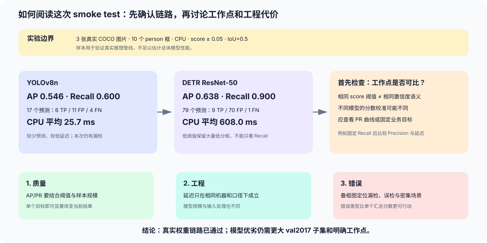

# COCO8 真实权重 Smoke Test

本记录用于证明视觉检测项目的真实数据链路已经贯通，不作为模型排行榜或最终性能结论。

## 实验范围

- 日期：2026-10-01
- 数据：Ultralytics COCO8 中包含 `person` 的 3 张真实 COCO train2017 图片
- 真实框：10 个非 crowd `person` 框
- 模型：YOLOv8n、`facebook/detr-resnet-50@main`
- 权重：官方预训练权重；DETR 使用 safetensors
- 设备：CPU
- 输入：YOLO 固定 `imgsz=640`；DETR 使用 checkpoint 自带预处理配置
- 阈值：最低置信度 0.05，IoU 0.5
- 计时：排除磁盘读取和模型加载，包含预处理、前向和后处理；第一张图预热一次

COCO8 是 Ultralytics 官方用于快速测试检测管线的小型 COCO 子集。这里只使用其中含人物标注的图片，因此样本规模不足以估计稳定的泛化性能。

## 本机结果

| 模型 | AP@0.5 | Precision | Recall | TP / FP / FN | 平均延迟 | 中位延迟 | P95 |
|---|---:|---:|---:|---:|---:|---:|---:|
| YOLOv8n | 0.546 | 0.353 | 0.600 | 6 / 11 / 4 | 25.7 ms | 25.0 ms | 28.4 ms |
| DETR ResNet-50 | 0.638 | 0.114 | 0.900 | 9 / 70 / 1 | 608.0 ms | 602.2 ms | 629.3 ms |

环境版本：Python 3.11.5、PyTorch 2.5.1、Transformers 4.57.6、Ultralytics 8.4.170。数字仅代表本次 CPU 环境。

*结果解读图：先用这组数字确认真实模型、统一指标和错误可视化链路已经工作，再检查阈值校准、硬件和样本量边界。相同的 0.05 分数阈值并不保证两个模型处在相同业务工作点，因此不能用当前 Precision、Recall 或延迟中的任意单项直接宣布胜负。*

## 如何解释

1. 两个真实模型都能输出到同一坐标、类别和评价契约，说明数据与适配器链路成立。
2. DETR 在 0.05 阈值下保留了大量低分预测，因此召回率高而精确率低；这首先反映分数校准和工作点差异，不能直接解释为模型结构优劣。
3. YOLOv8n 的本机延迟明显更低，但它和 DETR ResNet-50 的参数规模、输入处理和架构目标不同；这里的延迟只说明该组合在本机 CPU 上的工程代价。
4. 只有 3 张图片时，单个目标就会显著改变 AP 和 Recall，不能据此判断模型总体精度。

## 阈值扫描与工作点

在 0.05 候选收集下限之上扫描置信度后，两种模型在这个极小样本上的最佳 F1 点如下。数值用于检查工作点选择功能，不代表稳定的阈值建议。

| 模型 | 最佳 F1 阈值 | Precision | Recall | F1 | Recall=0.8 工作点 |
|---|---:|---:|---:|---:|---|
| YOLOv8n | 0.284 | 1.000 | 0.500 | 0.667 | 当前候选中不可达 |
| DETR ResNet-50 | 0.966 | 1.000 | 0.500 | 0.667 | 阈值 0.148，Precision 0.211 |

两个最佳点恰好相同，是 10 个真实框的小样本离散效应，不应解释为模型能力相同。更重要的观察是：达到相似 Recall 时两个模型需要的原始分数阈值明显不同，因此统一使用 0.05 只能用于收集候选，不能作为公平工作点。

运行脚本还会生成 `precision_recall_curve.png` 和 `latency_comparison.png`。前者应结合样本规模阅读；这里只有 3 张图，所以阶梯很粗，扩大到固定 50 张样本后才适合做方法对比。

## 正式对比后的继续加深

- 固定 50 张 COCO val2017 教学基准已经完成，结果见 [`VAL2017_RESULTS.md`](VAL2017_RESULTS.md)；
- 根据业务漏检与误检成本，从已有 PR 曲线中确定最终部署工作点；
- 按小目标、遮挡、密集目标和背景干扰标注错误类型；
- 在同一机器上重复多轮计时，并报告波动范围；
- 保留模型版本、输入尺寸、软件版本和原始 `metrics.json`。

因此，本次结果应表述为“真实权重 smoke test 通过”，而不是“YOLO 或 DETR 更好”。
